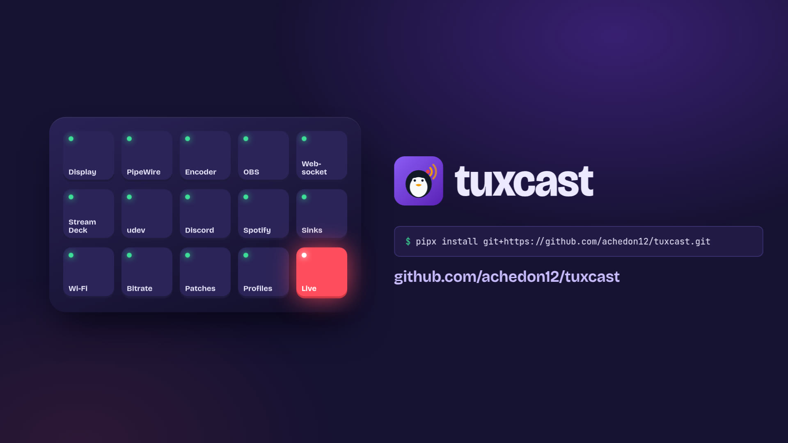
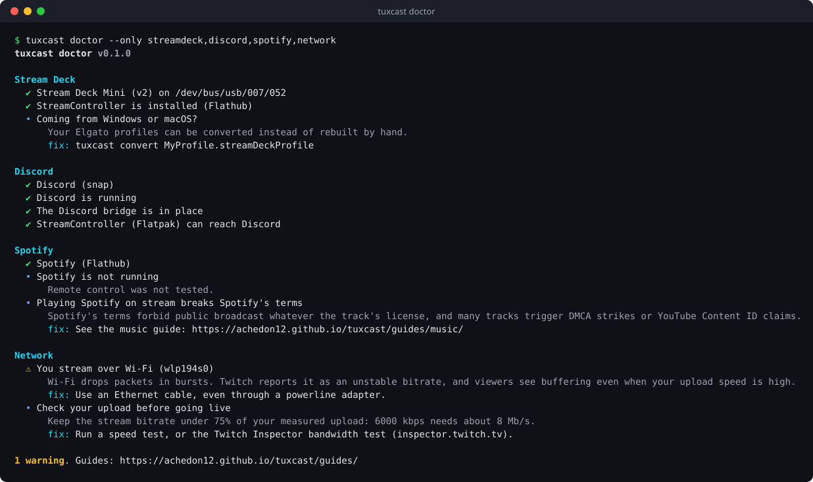

<p align="center">
  
</p>

<p align="center">
  <a href="https://github.com/achedon12/tuxcast/actions/workflows/ci.yml"></a>
  <a href="https://github.com/achedon12/tuxcast/releases"></a>
  
  
  <a href="LICENSE"></a>
</p>

<p align="center">
  <a href="README.md">English</a> · <b>Français</b>
</p>

**tuxcast** repère ce qui va casser ton stream avant que tu lances le live, puis le répare. Il
convertit tes profils Elgato Stream Deck, reconnecte les applis que Flatpak et snap isolent,
et sépare ton audio pour que chaque source ait son propre fader. Une commande pour chaque
problème, sans root et sans dépendance.

```sh
pipx install git+https://github.com/achedon12/tuxcast.git
tuxcast doctor
```

<p align="center">
  <a href="https://achedon12.github.io/tuxcast/#intro">
    <br>
    <sub>▶ tuxcast en 22 secondes</sub>
  </a>
</p>

<p align="center">
  
</p>

## Pourquoi

Streamer sous Linux marche bien, jusqu'au jour où ça casse, et ça casse toujours aux mêmes endroits :

- 🎛️ **Le Stream Deck.** Le logiciel Elgato n'existe pas sous Linux, et il faut refaire toutes ses pages à la main.
- 🔇 **Les touches Discord ne font rien.** L'appli du Stream Deck est en Flatpak, Discord en snap, et aucun ne voit l'autre.
- ⏯️ **Les touches média non plus.** Le snap de Spotify ignore les commandes à distance.
- 🎚️ **Un seul mix audio.** Impossible de retirer la musique des VOD ou de baisser Discord seul.
- 📶 **« Débit instable ».** Twitch accuse ta connexion alors que le speedtest est bon (c'est le Wi-Fi).

Chacun de ces problèmes a une solution perdue dans un fil de forum. tuxcast les détecte tous et applique les correctifs.

## Ce qu'il fait

| Commande | |
| --- | --- |
| `tuxcast doctor` | Vérifie le serveur d'affichage, l'audio, l'encodeur GPU, OBS, le Stream Deck, Discord, Spotify et le réseau. Chaque problème est accompagné de son correctif |
| `tuxcast convert` | Transforme les exports Elgato `.streamDeckProfile` en pages [StreamController](https://streamcontroller.core447.com/) : images, dossiers, multi-actions, raccourcis (AZERTY et QWERTZ gérés), touches OBS, Discord et Twitch |
| `tuxcast bridge discord` | Rend le socket de Discord (snap, Vesktop, natif) visible aux applis Flatpak, et recrée le pont à chaque connexion |
| `tuxcast audio` | Sorties PipeWire séparées pour le jeu, la musique, le vocal et les alertes, et y envoie les applis |
| `tuxcast deck` | Liste les Stream Deck, donne la règle udev nécessaire, et réinitialise un Stream Deck figé après un plantage, sans le débrancher |
| `tuxcast patch` | Réapplique les modifications que tu as faites dans les fichiers d'une appli à chaque fois qu'une mise à jour les efface |

## Installation

Il faut Python 3.11 ou plus récent, fourni par toutes les distributions actuelles.

```sh
pipx install git+https://github.com/achedon12/tuxcast.git
tuxcast doctor
```

## Documentation

Le [site](https://achedon12.github.io/tuxcast/) (en anglais, aussi dans le [wiki](https://github.com/achedon12/tuxcast/wiki))
détaille chaque commande et propose un guide pour chaque partie du setup : OBS, Stream Deck,
routage audio, Discord et Spotify dans les sandboxes, musique sans claims, réseau.

## Contribuer

Chaque setup Linux est différent, donc tes retours comptent autant que le code : un check du
doctor qui se trompe sur ta machine, une action Elgato non convertie, un guide qui oublie ton
bureau. Voir [CONTRIBUTING.md](CONTRIBUTING.md). Les issues et les PR en français sont les bienvenues.

Si tuxcast a sauvé ton stream, une ⭐ aide d'autres streamers sous Linux à le trouver.

## Licence

[MIT](LICENSE). tuxcast n'est affilié ni à Elgato, ni à OBS, Discord, Spotify ou Twitch.
