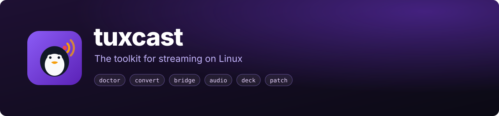
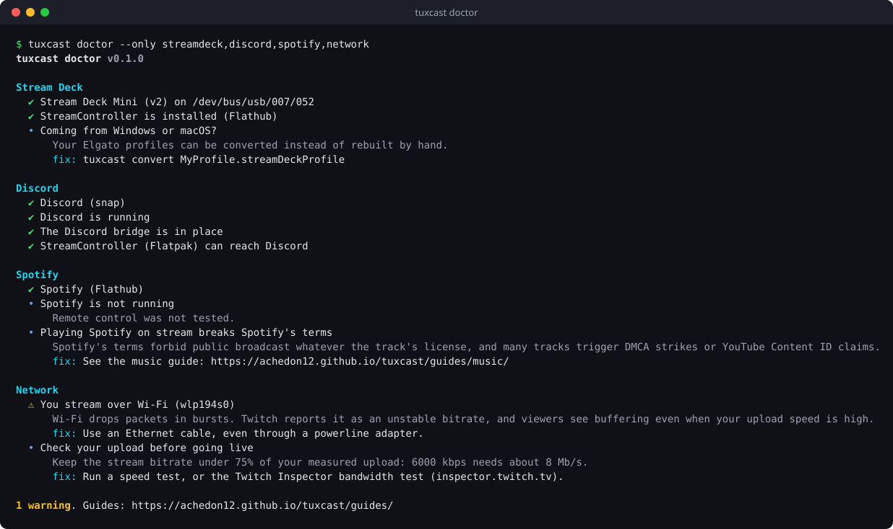
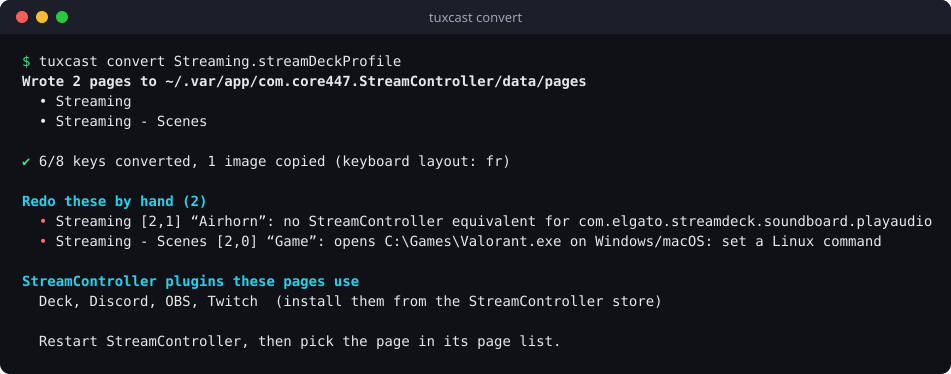

<p align="center">
  
</p>

<p align="center">
  <a href="https://github.com/achedon12/tuxcast/actions/workflows/ci.yml"></a>
  <a href="https://github.com/achedon12/tuxcast/releases"></a>
  
  
  
  <a href="LICENSE"></a>
  <a href="https://achedon12.github.io/tuxcast/"></a>
</p>

<p align="center">
  <b>English</b> · <a href="README.fr.md">Français</a>
</p>

**tuxcast** finds what will break your stream before you go live, then fixes it. It converts
your Elgato Stream Deck profiles, connects the apps Flatpak and snap keep apart, and splits
your audio so every source gets its own fader. One command each, no root, no dependencies.

```sh
pipx install git+https://github.com/achedon12/tuxcast.git
tuxcast doctor
```

<p align="center">
  
</p>

## Why

Streaming on Linux works well, until it doesn't, and it always breaks in the same places:

- 🎛️ **Your Stream Deck.** Elgato's app does not exist for Linux, and your 8 pages of keys need rebuilding by hand.
- 🔇 **Discord keys that do nothing.** Your Stream Deck app is a Flatpak, Discord is a snap, and neither can see the other.
- ⏯️ **Media buttons that do nothing either.** The Spotify snap ignores remote control.
- 🎚️ **One audio mix.** You can't keep the music out of your VODs or lower Discord alone.
- 📶 **"Unstable bitrate."** Twitch blames your connection and your speed test says it's fine (it's the Wi-Fi).

Each of these has a fix buried in a forum thread. tuxcast checks for all of them and applies the fixes.

## What it does

| Command | |
| --- | --- |
| [`tuxcast doctor`](https://achedon12.github.io/tuxcast/commands/doctor/) | Checks display server, audio, GPU encoder, OBS, Stream Deck, Discord, Spotify and network. Each problem comes with its fix |
| [`tuxcast convert`](https://achedon12.github.io/tuxcast/commands/convert/) | Turns Elgato `.streamDeckProfile` exports into [StreamController](https://streamcontroller.core447.com/) pages: images, folders, multi actions, hotkeys (AZERTY and QWERTZ aware), OBS, Discord and Twitch keys |
| [`tuxcast bridge discord`](https://achedon12.github.io/tuxcast/commands/bridge/) | Exposes Discord's socket (snap, Vesktop, native) to Flatpak clients, and recreates the bridge at every login |
| [`tuxcast audio`](https://achedon12.github.io/tuxcast/commands/audio/) | Separate PipeWire sinks for game, music, voice and alerts, and routes apps to them |
| [`tuxcast deck`](https://achedon12.github.io/tuxcast/commands/deck/) | Lists Stream Decks, prints the udev rule they need, and resets one that froze after a crash, without unplugging it |
| [`tuxcast patch`](https://achedon12.github.io/tuxcast/commands/patch/) | Re-applies the fixes you made to app files every time an update wipes them |

### Bring your Stream Deck profiles from Windows

<p align="center">
  
</p>

## Install

You need Python 3.11 or newer, which every current distribution ships.

```sh
pipx install git+https://github.com/achedon12/tuxcast.git
```

or `uv tool install git+https://github.com/achedon12/tuxcast.git`, or the
[installer script](install.sh) (`curl -fsSL https://raw.githubusercontent.com/achedon12/tuxcast/main/install.sh | sh`).
Then start with `tuxcast doctor`.

## Guides

The [website](https://achedon12.github.io/tuxcast/) (also in the [wiki](https://github.com/achedon12/tuxcast/wiki))
has a guide for each part of a Linux streaming setup, with the manual steps for people who
prefer to do it by hand:

[Streaming on Linux in 2026](https://achedon12.github.io/tuxcast/guides/streaming-on-linux/) ·
[OBS on Linux](https://achedon12.github.io/tuxcast/guides/obs/) ·
[Stream Deck on Linux](https://achedon12.github.io/tuxcast/guides/stream-deck/) ·
[Audio routing](https://achedon12.github.io/tuxcast/guides/audio/) ·
[Discord and Spotify in sandboxes](https://achedon12.github.io/tuxcast/guides/sandboxes/) ·
[Music without claims](https://achedon12.github.io/tuxcast/guides/music/) ·
[Network](https://achedon12.github.io/tuxcast/guides/network/)

## Principles

- **Reads before it writes.** `doctor` never changes anything. Other commands say what they wrote, and most take `--dry-run`.
- **Never needs root.** Everything happens in your user session. The one privileged step (the udev rule) is printed for you to run.
- **Zero dependencies.** Python's standard library only, so it installs in seconds and keeps working.
- **Explains itself.** Every warning says why it matters on stream and how to fix it.

## Roadmap

- [x] Doctor, converter, Discord bridge, audio sinks, deck tools, patch keeper
- [ ] `tuxcast obs`: apply encoder presets and multistream outputs to an OBS profile
- [ ] More Elgato plugins in `convert` (soundboard, Spotify, Voicemeeter equivalents)
- [ ] A `doctor --watch` mode to keep in an OBS dock while live
- [ ] Packages on PyPI and the AUR

Ideas and votes go to [Discussions](https://github.com/achedon12/tuxcast/discussions).

## Contributing

Every Linux setup is a little different, so your reports matter as much as code: a doctor
check that got your machine wrong, an Elgato action that didn't convert, a guide missing your
desktop. See [CONTRIBUTING.md](CONTRIBUTING.md). Issues labelled
[good first issue](https://github.com/achedon12/tuxcast/labels/good%20first%20issue) are a
good start; most Elgato mappings are one line.

If tuxcast saved your stream, a ⭐ helps other Linux streamers find it.

## License

[MIT](LICENSE). tuxcast is not affiliated with Elgato, OBS, Discord, Spotify or Twitch.
