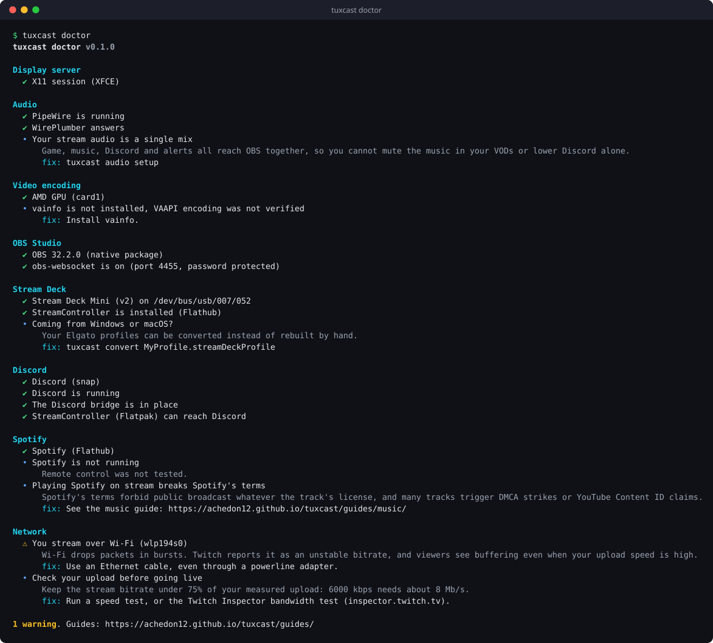

# tuxcast doctor

Checks your streaming setup and explains how to fix what is wrong. It only reads: running it
never changes anything.

```sh
tuxcast doctor                     # every topic
tuxcast doctor --only obs,network  # some topics
tuxcast doctor --verbose           # details of passing checks too
tuxcast doctor --json              # for scripts and bug reports
```

{ .terminal }

It exits with status `1` when a check fails, so `tuxcast doctor && obs` only starts OBS on a
healthy setup.

## What it checks

| Topic | Checks |
| --- | --- |
| `display` | Wayland or X11; on Wayland, the screen capture portal, and what it means for hotkeys |
| `audio` | PipeWire running, WirePlumber answering, separate sinks for the stream |
| `encoders` | Your GPU, the encoder OBS should use (NVENC, VAAPI, QuickSync), whether the driver can encode |
| `obs` | Installed (native or Flathub), recent enough, obs-websocket on and password protected |
| `streamdeck` | Decks plugged in, model, USB permission, a Linux app to drive them |
| `discord` | How Discord is installed, its IPC socket, whether Flatpak clients can reach it |
| `spotify` | Snap or Flathub, conflicting installs, remote control through MPRIS |
| `network` | Wi-Fi or cable, and the bitrate your upload allows |

## Reading the output

| Symbol | Meaning |
| --- | --- |
| ✔ | Fine |
| • | Worth knowing, no action needed |
| ⚠ | Works, but likely to cause trouble on stream |
| ✖ | Broken: fix it before going live |
| ○ | Skipped (nothing to check, e.g. no Stream Deck plugged in) |

## JSON output

```json
[
  {
    "topic": "network",
    "title": "Network",
    "findings": [
      {
        "status": "warn",
        "summary": "You stream over Wi-Fi (wlp194s0)",
        "detail": "Wi-Fi drops packets in bursts…",
        "fix": "Use an Ethernet cable, even through a powerline adapter."
      }
    ]
  }
]
```

`status` is one of `ok`, `info`, `warn`, `fail`, `skip`. Paste this output in bug reports: it
describes your setup without anything private.
