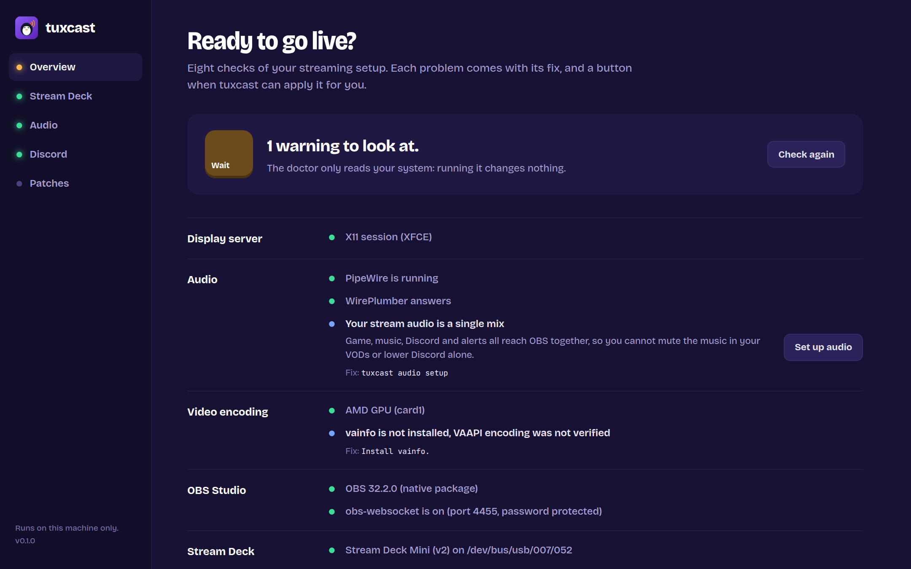
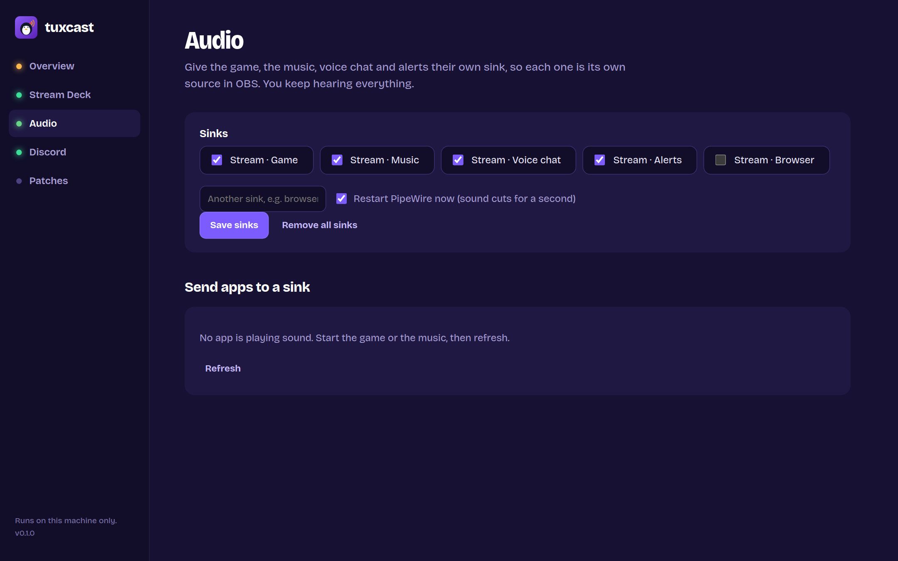

# tuxcast ui

Everything tuxcast does, in a dashboard you can click through.

```sh
tuxcast ui
```

```text
tuxcast dashboard
  http://127.0.0.1:41873/?token=Hk3v…
  Local only: it runs on this machine. Ctrl+C to stop.
```

Your browser opens on the address. Stop the dashboard with Ctrl+C.

{ .terminal }

## What it shows

| Section | What you can do |
| --- | --- |
| **Overview** | The [doctor](doctor.md)'s checks, with a button when tuxcast can apply the fix |
| **Stream Deck** | Drop an Elgato profile, preview its pages key by key, convert them; see your decks, reset a frozen one, copy the udev rule |
| **Audio** | Pick the sinks to create, restart PipeWire, send each app playing sound to its sink |
| **Discord** | See where Discord's socket is and connect it to your Flatpak apps in one click |
| **Patches** | See whether your patches are applied, apply them, re-apply them after every update |

### Converting a profile

{ .terminal }

Drop your `.streamDeckProfile` on the page. tuxcast shows every page and folder as it will look in
StreamController, with the real key images. Keys outlined in amber convert but deserve a check; keys
outlined in red need an action picked by hand. Select a key to see why. Nothing is written until you
click **Convert**.

### Audio

{ .terminal }

## Options

| Option | |
| --- | --- |
| `--port PORT` | Listen on this port (default: a free one) |
| `--no-browser` | Print the address without opening it |
| `--layout LAYOUT` | Keyboard layout for converted hotkeys (default: detected) |

## Security

The dashboard can change your setup, so it is locked to you:

- it only listens on `127.0.0.1`, never on your network;
- every request must carry the random token in the printed address, which other websites open in
  your browser cannot know;
- requests whose `Host` or `Origin` is not the dashboard itself are refused, which blocks DNS
  rebinding and cross-site requests;
- its pages forbid inline scripts and outside resources (Content Security Policy), and everything
  read from a profile is shown as text, never as HTML.

The token changes every time you start `tuxcast ui`.
