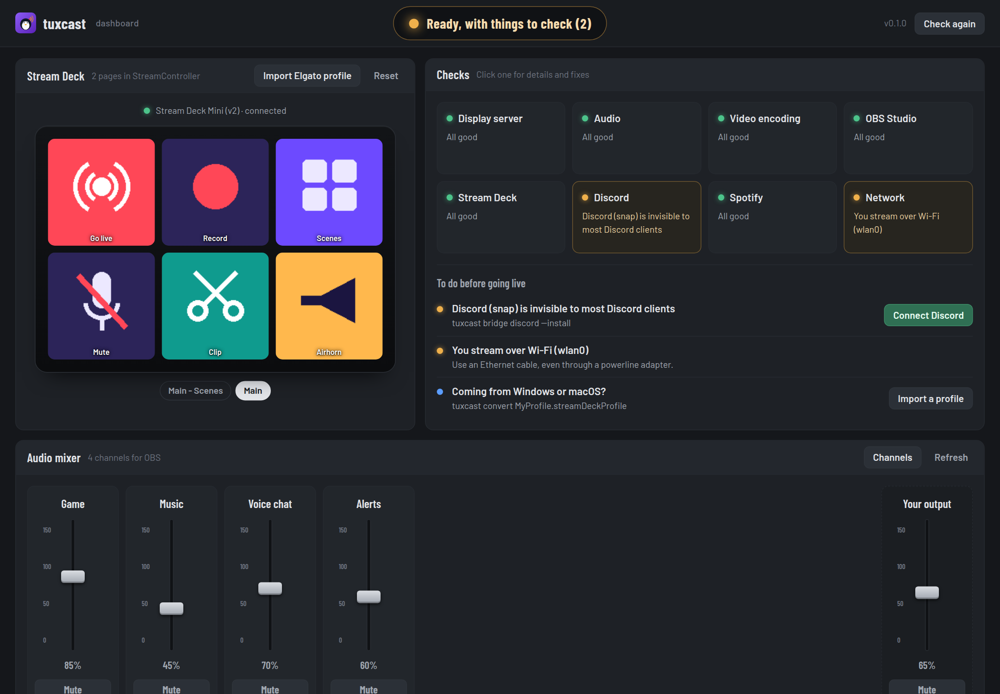
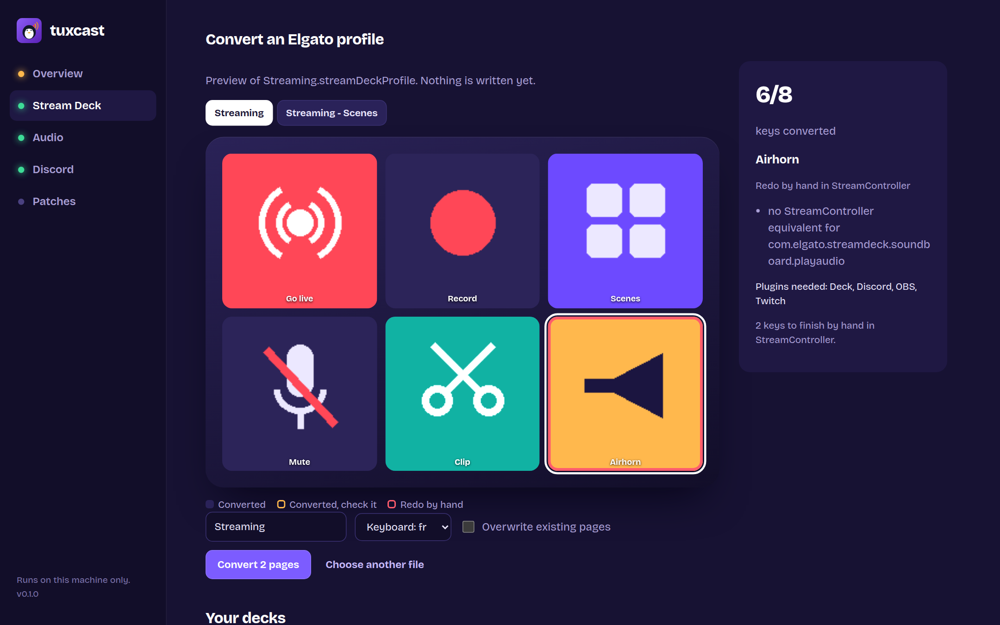
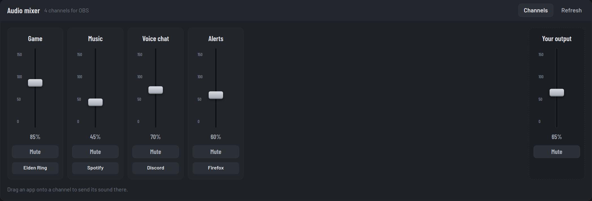

# tuxcast ui

Everything tuxcast does, on a control desk in your browser.

```sh
tuxcast ui
```

```text
tuxcast dashboard
  http://127.0.0.1:41873/?token=Hk3v…
  Local only: it runs on this machine. Ctrl+C to stop.
```

Your browser opens on the address. Stop the dashboard with Ctrl+C.

<video controls preload="none" playsinline poster="../../assets/tuxcast-ui.jpg" width="1920" height="1080" style="width:100%;height:auto;border-radius:10px">
  <source src="../../assets/tuxcast-ui.mp4" type="video/mp4">
</video>

{ .terminal }

## Try it

The website has a [live demo](../demo/index.html): the dashboard itself, with sample data. Connect
Discord, create the audio channels and move the faders, drop a profile on the deck. Nothing leaves
the page.

[Open the live demo](../demo/index.html){ .md-button .md-button--primary }

## The desk

| Module | What it does |
| --- | --- |
| **Tally** | The big light at the top: green when you can go live, amber when something deserves a look, red when something is broken |
| **Stream Deck** | Your deck as it is configured: StreamController's real pages and key images, page by page. Reset a frozen deck, get the permission rule |
| **Checks** | The [doctor](doctor.md)'s eight areas. Click one for the details and fixes; the list below says what to do before going live, with a button when tuxcast can do it |
| **Audio mixer** | A channel strip per [audio channel](audio.md): fader, mute, and the apps playing into it. Drag an app onto another channel to move its sound there |
| **Discord** | Where Discord's socket is, whether StreamController can reach it, and the button that connects them |
| **Patches** | Your [patches](patch.md), applied or not, and whether they come back after updates |

### Importing an Elgato profile

{ .terminal }

Click **Import Elgato profile** and drop your `.streamDeckProfile` on the deck. Every page and folder
appears on the deck as it will in StreamController, with its key images. Keys outlined in amber
convert but deserve a check; keys outlined in red need an action picked by hand. Select a key to see
why. Nothing is written until you click **Convert**.

### The mixer

{ .terminal }

Faders and mute buttons act on PipeWire directly, like `pactl` would. Your normal output stays on
the right, like a master channel. With no channel yet, the mixer offers to create them.

## Options

| Option | |
| --- | --- |
| `--port PORT` | Listen on this port (default: a free one) |
| `--no-browser` | Print the address without opening it |
| `--layout LAYOUT` | Keyboard layout for converted hotkeys (default: detected) |

## Security

The dashboard can change your setup, so it is locked to you:

- it only listens on `127.0.0.1`, never on your network;
- every request must carry the random token in the printed address, which other websites open in
  your browser cannot know, and the token is checked before a request body is even read;
- requests whose `Host` or `Origin` is not the dashboard itself are refused, which blocks DNS
  rebinding and cross-site requests;
- its pages forbid inline scripts and outside resources (Content Security Policy), everything read
  from a profile is shown as text, never as HTML, and only real image files are ever sent as key images.

The token changes every time you start `tuxcast ui`.
