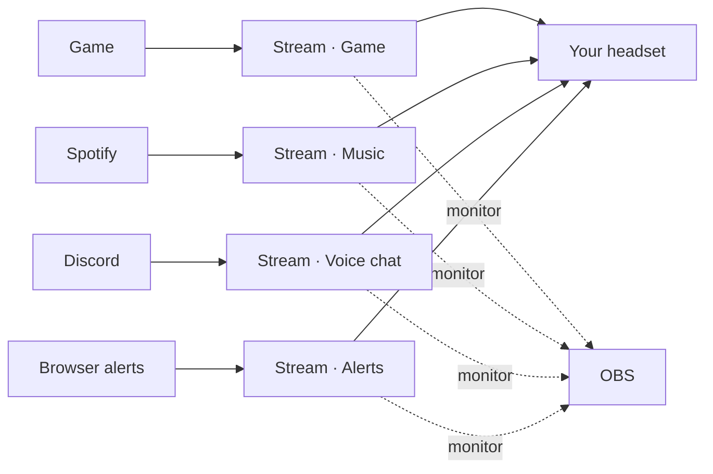

# Audio routing

Goal: each part of your stream sound is its own source in OBS, so you can mix, filter and
record them separately, while you keep hearing everything in your headset.



## 1. Create the sinks

```sh
tuxcast audio setup --restart
```

This declares four sinks (*Stream · Game*, *Music*, *Voice chat*, *Alerts*) in
`~/.config/pipewire/pipewire.conf.d/tuxcast-sinks.conf`. Each is a loopback to your default
output. Choose your own with `--sinks game,music,voice,browser`.

## 2. Send apps to them

While an app plays sound:

```sh
tuxcast audio route spotify music
tuxcast audio route discord voice
tuxcast audio route firefox alerts
```

or use `pavucontrol` (Playback tab) or your desktop's sound settings. PipeWire remembers the
choice for the next time the app plays. Games: start them, then route them to `game`.

## 3. Capture them in OBS

For each sink: **Sources → + → Audio Output Capture (PulseAudio)**, device
*Monitor of Stream · Music* (and so on). Then mute OBS's global *Desktop Audio* so nothing is
captured twice.

## 4. Keep the music out of your VODs (Twitch)

1. **Settings → Output → Output Mode: Advanced → Streaming**: tick **Twitch VOD Track** and
   pick track 2. The option appears when the stream service is Twitch.
2. **Edit → Advanced Audio Properties**: give every source tracks 1 and 2, except the music
   source, which only gets track 1.

Live viewers hear the music; the VOD, built from track 2, does not.

## Without virtual sinks

The [obs-pipewire-audio-capture](https://github.com/dimtpap/obs-pipewire-audio-capture) plugin
captures one application directly. It is simpler when you only need OBS to separate apps;
tuxcast's sinks also let other tools (a recorder, a meter, Discord's own capture) see the same
split.

## Undo

```sh
tuxcast audio remove --restart
```
