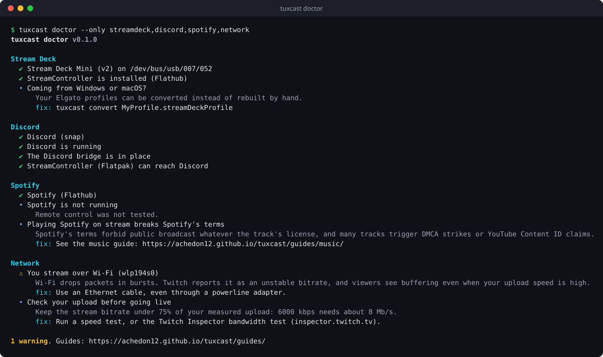

<div class="hero" markdown>

{ .hero-logo }

# Stream on Linux without the guesswork

**tuxcast** finds what will break your stream before you go live, converts your Elgato
Stream Deck profiles, connects the apps Flatpak and snap keep apart, and splits your audio so
every source is its own fader.

[Get started](getting-started.md){ .md-button .md-button--primary }
[Browse the guides](guides/index.md){ .md-button }

</div>

```console
$ pipx install git+https://github.com/achedon12/tuxcast.git
$ tuxcast doctor
```

{ .terminal }

<div class="grid cards" markdown>

-   :material-stethoscope:{ .lg .middle } **`tuxcast doctor`**

    ---

    Eight checks (display server, audio, GPU encoder, OBS, Stream Deck, Discord, Spotify,
    network), each with the exact fix.

    [:octicons-arrow-right-24: doctor](commands/doctor.md)

-   :material-keyboard-variant:{ .lg .middle } **`tuxcast convert`**

    ---

    Your Elgato `.streamDeckProfile` becomes StreamController pages: images, folders, hotkeys,
    OBS, Discord and Twitch keys.

    [:octicons-arrow-right-24: convert](commands/convert.md)

-   :material-bridge:{ .lg .middle } **`tuxcast bridge discord`**

    ---

    Discord as a snap or Vesktop, StreamController as a Flatpak: mute keys and rich presence work
    again.

    [:octicons-arrow-right-24: bridge](commands/bridge.md)

-   :material-tune-vertical:{ .lg .middle } **`tuxcast audio`**

    ---

    Separate sinks for game, music, voice and alerts. Mute the music in your VODs, lower Discord
    alone.

    [:octicons-arrow-right-24: audio](commands/audio.md)

-   :material-usb:{ .lg .middle } **`tuxcast deck`**

    ---

    Udev rule, device list, and a reset for the deck that froze after a crash. No unplugging.

    [:octicons-arrow-right-24: deck](commands/deck.md)

-   :material-bandage:{ .lg .middle } **`tuxcast patch`**

    ---

    The fix you made to a plugin keeps vanishing at each update? Describe it once, it comes back
    by itself.

    [:octicons-arrow-right-24: patch](commands/patch.md)

</div>

## Why tuxcast

Streaming on Linux works, and works well, until it doesn't. The problems are always the same:
an Elgato app that does not exist, a Flatpak that cannot see a snap, a Wi-Fi link that Twitch
calls unstable, a single audio mix you cannot split. Each has a fix buried in a forum thread.
tuxcast collects those fixes, checks for them automatically, and applies them for you.

- **Zero dependencies.** Python 3.11 and nothing else. Installs in seconds with pipx.
- **Never needs root.** Everything happens in your user session; the one privileged step is
  printed for you to run.
- **Reads before it writes.** `doctor` changes nothing, every other command supports
  `--dry-run` or says exactly what it wrote.
